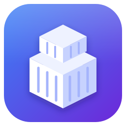
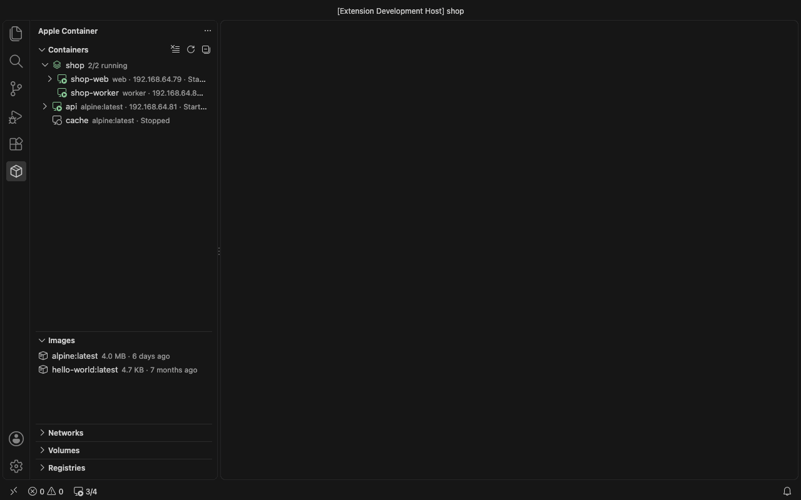
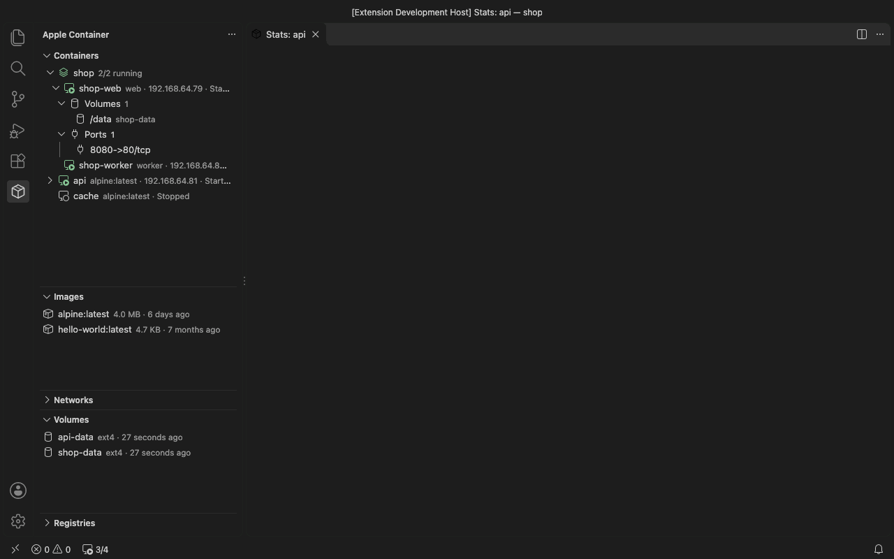
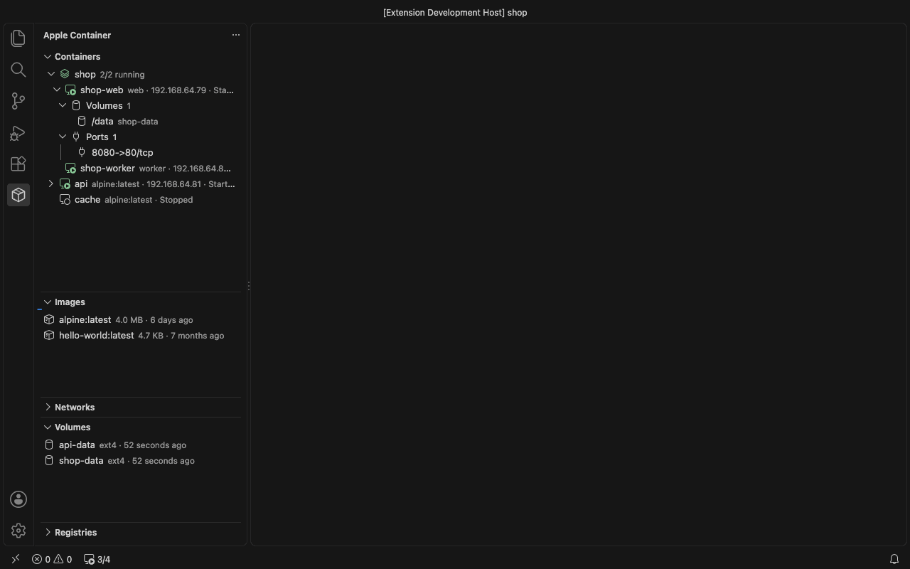
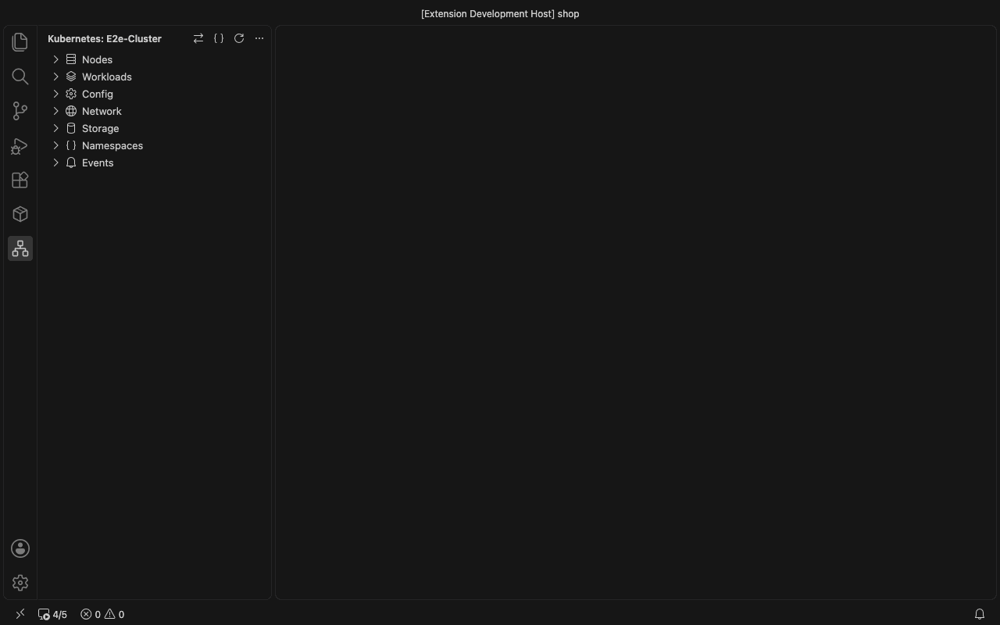

# Apple Container Tools

**Manage [Apple `container`](https://github.com/apple/container), native Linux containers on macOS, from VS Code and Cursor.**

[Install](#installation) · [Features](#features) · [Kubernetes](#kubernetes-clusters) · [Remote-SSH](#remote-ssh) · [Dev containers](#dev-containers) · [Settings](#settings) · English | [简体中文](README.zh-CN.md)

## Highlights

- 🧭 **One sidebar** for containers, images, networks, volumes, registries, container-compose projects and the `container` service.
- ☸️ **Kubernetes clusters** of `container cluster`, browsed like Lens.
- 🐧 **Machines** of `container machine`: persistent Linux environments with your Mac user and home directory.
- 🖥️ **Containers, machines and pods as remote workspaces** over Remote-SSH, with no published port or running SSH daemon.
- 📦 **`devcontainer.json` without Docker**, features and lifecycle commands included.
- 📝 **Forms** to run, edit and build, and **English and Simplified Chinese**.

## Requirements

| | |
|---|---|
| Hardware | Mac with Apple silicon |
| `container` CLI | [apple/container](https://github.com/apple/container/releases), tested with 1.7.1 |
| Editor | VS Code 1.90 or later, or Cursor |
| Optional | [container-compose](https://github.com/mcrich23/container-compose); the Remote - SSH extension; `kubectl` (downloaded on request) |

## Installation

- **VS Code**: [Marketplace](https://marketplace.visualstudio.com/items?itemName=fqix.apple-container-tools), or `ext install fqix.apple-container-tools` in Quick Open (`⌘P`).
- **Cursor and other Open VSX editors**: [Open VSX](https://open-vsx.org/extension/fqix/apple-container-tools).
- **VSIX** from [GitHub Releases](https://github.com/fqix/mac-container/releases): `code --install-extension apple-container-tools-darwin-arm64-0.11.0.vsix`

Then open **Apple Container** in the activity bar; if the service is stopped, start it from there or the status bar.

## Features

### Containers

- Start, stop, restart, kill, delete and prune; **Attach Shell**, **View Logs**, **Upload Files...** / **Download...**.
- Expand a container for its **Volumes** and **Ports**, including ports it listens on without publishing them.
- **Show Stats** for live CPU, memory, network and disk charts.

  

- **Edit...** changes ports, mounts, environment, networks, CPUs, memory and user. Apple `container` cannot change these in place, so the container is recreated; **Keep Changes and Recreate** snapshots it first.

  

### Images and more

- Images: pull, tag, push, delete, prune, export / import OCI archives; **Build Image...** and **Run...** open forms.
- Networks, volumes, registry logins, and the BuildKit builder.
- container-compose projects are grouped, with start, stop, delete and **Compose Up** / **Compose Down**.
- The status bar starts or stops the service and opens the **System Overview** (versions, paths, disk usage with prune).

### Machines

A machine of `container machine` (container 1.7.1) is a persistent Linux environment that boots the image's `/sbin/init`, with an account matching your Mac user and your Mac home directory mounted at the same path. The **Machines** view lists them.

- **New Machine...** picks an image (it must have `/sbin/init`, such as `alpine:latest`; type a reference to pull it), a name, CPUs, memory and how the home directory is mounted.
- **Open Shell** / **Open Root Shell** open a login shell, in the terminal's folder when it is under your home directory; a stopped machine boots first.
- Start, stop, restart, **Edit...** (CPUs, memory, home mount; applied on the next boot), **Set as Default**, logs, boot logs and delete.

### Kubernetes clusters

Clusters created with `container cluster` (container 1.7.1) have their own Activity Bar icon.

- One cluster at a time, named in the title: **Switch Cluster...**, **Switch Namespace...**, and create, delete or write a cluster's kubeconfig context from the title bar.
- Like Lens: Nodes, Workloads, Config, Network, Storage, Namespaces and Events, with **View YAML**, **Describe** and **Delete...**; pod logs, shell and **Open in Remote-SSH**; restart and scale for workloads.
- **New Resource...** opens a YAML template; **Apply to Cluster** in the editor title applies it, or any YAML file.
- Runs `kubectl` (offered for download from dl.k8s.io when missing) with a kubeconfig the extension keeps itself; `~/.kube/config` is left alone.

## Remote-SSH

Right-click a running container, a machine or a pod → **Open in Remote-SSH** and pick a folder. The window connects through `container exec` (`container machine run` for machines, which boots a stopped one; `kubectl exec` for pods), so no port or IP route is needed. A machine logs in as its own account, which matches your Mac user.

- Missing `openssh-server`, `bash` or `wget` is installed with the image's package manager (needs network access); a pod's container must run as root.
- `~/.ssh/config` gets one `Include ~/.ssh/apple-container/config` line; host entries and the key pair stay in `~/.ssh/apple-container/`.

## Dev containers

**Open Folder in Dev Container** creates the container from `devcontainer.json` with the bundled [Dev Containers CLI](https://github.com/devcontainers/cli) and opens it over Remote-SSH. The next open reuses it and asks to rebuild when the configuration changed; the window's Remote menu offers **Rebuild Container** and **Reopen Folder Locally**.

No configuration yet? **Add Dev Container Configuration...** (Command Palette or a folder's context menu) writes one from an official [Dev Container Template](https://containers.dev/templates) with its options and Features. The Templates ship with the extension, so this works offline; those that need Docker Compose or a Docker daemon, and Features that need Docker or a GPU, are left out. It can also install Claude Code, Codex, opencode, Kimi Code, MiMo Code or Qwen Code with their official install scripts in `postCreateCommand`, and put them on `PATH` for bash and zsh.

| Property | Support |
|---|---|
| `image`, `build`, `features`, mounts, env, users, lifecycle commands | ✅ |
| `appPort`, `capAdd`, `init`, `overrideCommand`, `hostRequirements` | ✅ |
| `customizations.vscode.extensions` | ✅ installed when the window connects |
| `forwardPorts` | ⚠️ forwarded by Remote-SSH, not published |
| `runArgs`, `privileged` | ⚠️ see [Limitations](#limitations) |
| `securityOpt`, `dockerComposeFile` | ❌ |

## Limitations

Each Apple `container` container is its own lightweight VM, not a process on a shared Docker daemon (checked against 1.7.1). Docker options without an equivalent are dropped with a warning in `devcontainer.json`.

| Docker option | In Apple `container` |
|---|---|
| `--privileged` | Becomes `--cap-add ALL`. |
| `--ipc`, `--pid`, `--userns`, `--cgroupns`, `--network host` | Not available: no shared host kernel. |
| `--device`, `--gpus`, mounts of `/dev`, `/proc`, `/sys` | Not available: the host is macOS. |
| `--security-opt`, `--add-host`, `--hostname`, Docker Compose, Docker-in-Docker | Not available. |

Memory is fixed per container (1 GB by default); dev containers get `appleContainer.devcontainer.memory`.

## Settings

| Setting | Default | Description |
|---|---|---|
| `appleContainer.path` | `container` | `container` CLI; also looked up in `/opt/homebrew/bin` and `/usr/local/bin`. |
| `appleContainer.composePath` | `container-compose` | `container-compose` CLI. |
| `appleContainer.kubectlPath` | | `kubectl` for clusters; empty uses `PATH`, then a downloaded one. |
| `appleContainer.cluster.kubeconfig` | | Kubeconfig that cluster create and delete update; empty: `KUBECONFIG`, else `~/.kube/config`. |
| `appleContainer.insecureRegistries` | `[]` | Registries reached over plain http. |
| `appleContainer.refreshInterval` | `5` | Refresh interval in seconds while a view is visible; `0` disables it. |
| `appleContainer.statsInterval` | `2` | Sampling interval of the stats charts in seconds. |
| `appleContainer.execShell` | `/bin/sh` | Shell started by **Attach Shell**. |
| `appleContainer.logTail` | `200` | Log lines shown first; `0` shows everything. |
| `appleContainer.sshUser` | | User for **Open in Remote-SSH**; empty uses the container's own user. |
| `appleContainer.devcontainer.memory` | `4G` | Memory for dev containers, or `hostRequirements.memory` when larger. |

## FAQ

<b>Does it work when my workspace is remote (SSH, Dev Containers, WSL)?</b>

Yes. The extension runs on the local UI side and manages the containers of your Mac. Building images and Compose need files on this Mac.

<b>Remote-SSH hangs while downloading the VS Code server.</b>

Without internet access in the container, enable `remote.SSH.localServerDownload` so the server is downloaded on the Mac and copied in.

<b><code>Compose Down</code> left the containers behind.</b>

`container-compose down` (1.2.0) stops but does not remove them. Use **Delete All Containers** on the project.

## Contributing

Issues and pull requests are welcome; see [CONTRIBUTING.md](CONTRIBUTING.md) and the [CHANGELOG](CHANGELOG.md). Built on [apple/container](https://github.com/apple/container), [container-compose](https://github.com/mcrich23/container-compose) and the [Dev Containers CLI](https://github.com/devcontainers/cli).

## License

[MIT](LICENSE)
