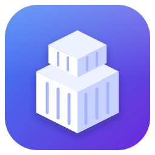
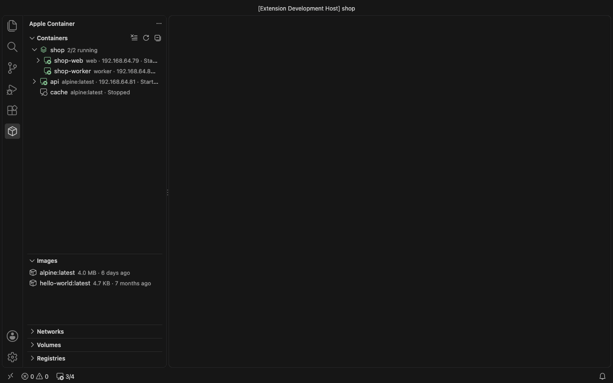
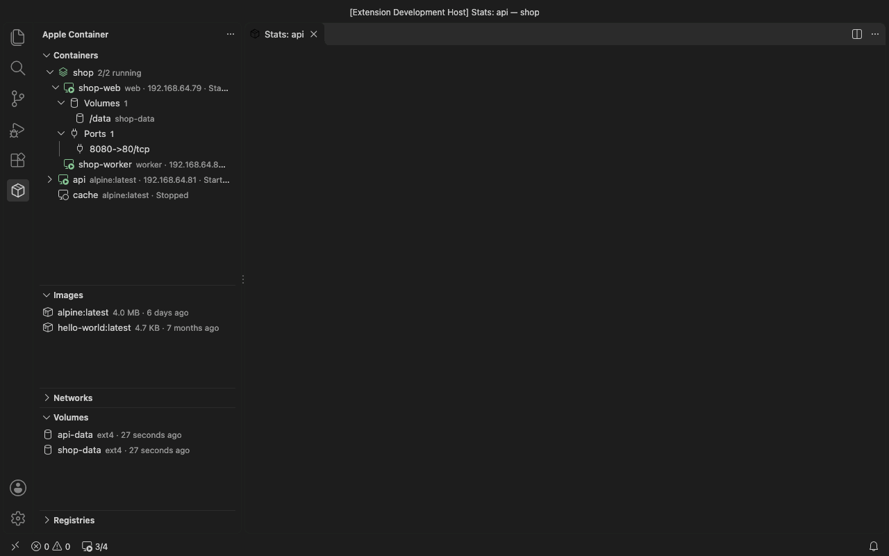
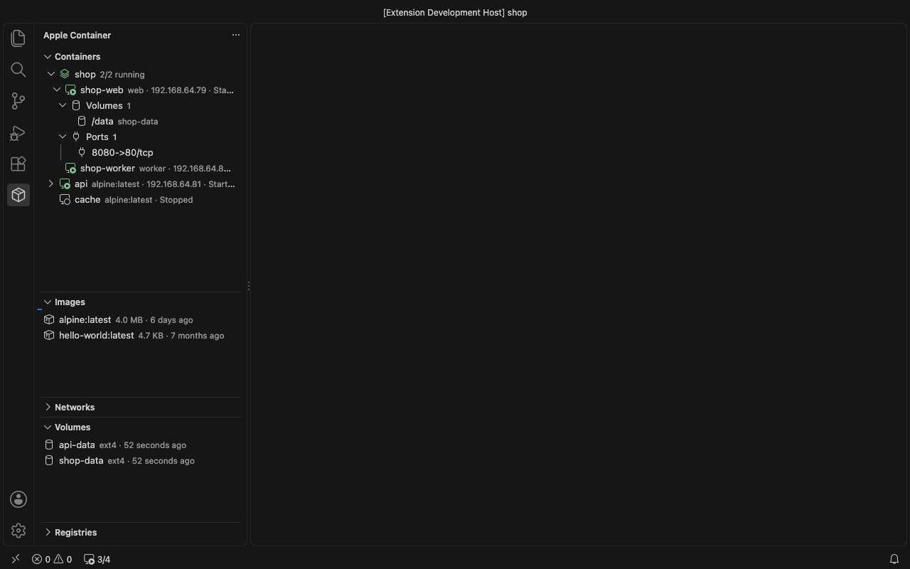

<div align="center">



# Apple Container Tools

**Manage [Apple `container`](https://github.com/apple/container), native Linux containers on macOS, from VS Code and Cursor.**

[](https://marketplace.visualstudio.com/items?itemName=fqix.apple-container-tools)
[](https://open-vsx.org/extension/fqix/apple-container-tools)
[](https://github.com/fqix/mac-container/actions/workflows/ci.yml)
[](#requirements)
[](LICENSE)

[Install](#installation) · [Features](#features) · [Remote-SSH](#open-a-container-over-remote-ssh) · [Dev containers](#dev-containers-devcontainerjson) · [Limitations](#limitations) · [Settings](#settings) · [Contributing](CONTRIBUTING.md) · English | [简体中文](README.zh-CN.md)



</div>

## Highlights

- 🧭 **One sidebar** for containers, images, networks, volumes, registries, container-compose projects and the `container` service.
- 🖥️ **Open a container as a remote workspace** over Remote-SSH, with no published port or running SSH daemon.
- 📦 **`devcontainer.json` without Docker**, features and lifecycle commands included.
- 📝 **Run and edit containers in a form**, and build images with build arguments, secrets and platforms.
- 🌐 **English and Simplified Chinese**.

## Requirements

| | |
|---|---|
| Hardware | Mac with Apple silicon |
| `container` CLI | [apple/container](https://github.com/apple/container/releases), tested with 1.6.1 |
| Editor | VS Code 1.90 or later, or Cursor |
| Optional | [container-compose](https://github.com/mcrich23/container-compose) for compose projects; the Remote - SSH extension for remote workspaces and dev containers |

## Installation

- **VS Code**: install [Apple Container Tools](https://marketplace.visualstudio.com/items?itemName=fqix.apple-container-tools) from the Marketplace, or run `ext install fqix.apple-container-tools` in Quick Open (`⌘P`).
- **Cursor and other Open VSX editors**: install from [Open VSX](https://open-vsx.org/extension/fqix/apple-container-tools).
- **VSIX**: download `apple-container-tools-darwin-arm64-<version>.vsix` from [GitHub Releases](https://github.com/fqix/mac-container/releases) and install it:

  ```bash
  code --install-extension apple-container-tools-darwin-arm64-0.7.0.vsix
  ```

## Quick start

1. Start the service with `container system start`, or click the **container** item in the status bar.
2. Open the **Apple Container** view in the activity bar.
3. Right-click an image → **Run...**, or a running container → **Attach Shell**, **Show Stats** or **Open in Remote-SSH**.
4. Got a `.devcontainer/devcontainer.json`? Open the folder and accept **Open in Dev Container**.

## Features

### Containers

- Start, stop, restart, kill, delete (multi-select) and prune; **Attach Shell**, **View Logs** and **View Boot Logs** in the terminal.
- Expand a container for its **Volumes** and **Ports**. Ports include those it listens on without publishing them, opened through the container's IP.
- **Upload Files...** / **Download...** by browsing the container, and **Show Stats** for live CPU, memory, network and disk charts.

  

- **Edit...** changes ports, mounts, environment variables, networks, CPUs, memory, user and working directory. Apple `container` cannot change these in place, so the container is recreated; **Keep Changes and Recreate** snapshots it first so files changed inside survive.

  

### Images

- Pull, tag, push, inspect, delete, prune, and export to or import from OCI tar archives.
- **Build Image...** opens a form for the tag, context, target stage, platforms (multi-platform included), build arguments, secrets and labels.
- **Run...** opens the same form as **Edit...**, with a name and an optional command.

### More

- **Builder**: the BuildKit container `container build` starts is listed among the containers, with start, stop, restart, logs and **Delete Builder...** to reset it and free its cache.
- **Networks**, **volumes** and **registry logins**.
- **container-compose**: containers are grouped by project, with start, stop, restart and delete for the whole project, and **Compose Up** / **Compose Down** from the project or a compose file.
- **Status bar**: whether the service runs and how many containers are up; click it to start or stop the service, or to view status, disk usage and logs.

## Open a container over Remote-SSH

Right-click a running container → **Open in Remote-SSH** and pick the folder to open by browsing the container. A new VS Code or Cursor window connects through `container exec`, so no port or IP route is needed.

- Packages Remote-SSH needs and the image lacks (`openssh-server`, `bash`, `wget`) are installed with its package manager; the output shows in a terminal. This needs network access from the container.
- Your SSH config gets one line, `Include ~/.ssh/apple-container/config`, at the top of `~/.ssh/config`; the host entries and the extension's key pair stay in `~/.ssh/apple-container/`.
- You log in as the container's own user (image `USER` or `--user`), or `appleContainer.sshUser`.

## Dev containers (devcontainer.json)

**Open Folder in Dev Container** creates the container from the folder's `devcontainer.json` with the bundled [Dev Containers CLI](https://github.com/devcontainers/cli), the reference implementation, then opens it over Remote-SSH. The build and the Remote-SSH preparation show as steps in one terminal. The next open reuses the container, and asks to rebuild when the configuration changed.

In the dev container's window, the Remote indicator menu and the Command Palette offer **Rebuild Container**, **Rebuild Container Without Cache**, **Reopen Folder Locally** and **Show Dev Container Log**.

| Property | Support |
|---|---|
| `image`, `build`, `features` | ✅ |
| `workspaceFolder`, `workspaceMount`, `mounts` | ✅ |
| `containerEnv`, `remoteEnv`, `containerUser`, `remoteUser` | ✅ |
| Lifecycle commands, `initializeCommand` to `postAttachCommand` | ✅ |
| `appPort`, `capAdd`, `init`, `overrideCommand`, `hostRequirements` | ✅ |
| `customizations.vscode.extensions` | ✅ installed when the window connects, from the editor's own marketplace |
| `forwardPorts` | ⚠️ not published; Remote-SSH forwards them, and **Ports** lists them with the container IP |
| `runArgs`, `privileged` | ⚠️ see [Limitations](#limitations) |
| `securityOpt`, `dockerComposeFile` | ❌ |

## Limitations

Every Apple `container` container is its own lightweight VM with its own Linux kernel, not a process on a shared Docker daemon, so some Docker options have no equivalent (checked against `container` 1.6.1). In `devcontainer.json` (`runArgs`, `privileged` or features), they are dropped with a warning and the container still starts.

| Docker option | In Apple `container` |
|---|---|
| `--privileged` | Becomes `--cap-add ALL`. |
| `--ipc`, `--pid`, `--userns`, `--cgroupns`, `--network host` | Not available: there is no shared host kernel. |
| `--device`, `--gpus`, mounts of `/dev`, `/proc` or `/sys` | Not available: the host is macOS. |
| `--security-opt`, `--add-host`, `--hostname` | Not available. |
| Docker Compose, Docker-in-Docker | Not available. [container-compose](https://github.com/mcrich23/container-compose) projects are supported; `dockerComposeFile` is not. |

Each container also has a fixed amount of memory (1 GB by default); dev containers get `appleContainer.devcontainer.memory`.

## Settings

| Setting | Default | Description |
|---|---|---|
| `appleContainer.path` | `container` | Path to the `container` CLI. Looked up in `PATH`, `/opt/homebrew/bin` and `/usr/local/bin`. |
| `appleContainer.composePath` | `container-compose` | Path to the `container-compose` CLI. |
| `appleContainer.insecureRegistries` | `[]` | Registries (`host` or `host:port`) reached over plain http. Loopback registries always are. |
| `appleContainer.refreshInterval` | `5` | Auto refresh interval in seconds while a view is visible; `0` disables it. |
| `appleContainer.statsInterval` | `2` | Sampling interval of the stats charts in seconds. |
| `appleContainer.execShell` | `/bin/sh` | Shell started by **Attach Shell**. |
| `appleContainer.logTail` | `200` | Lines shown when opening logs; `0` shows everything. |
| `appleContainer.sshUser` | _(empty)_ | User for **Open in Remote-SSH**. Empty uses the container's own user. |
| `appleContainer.devcontainer.memory` | `4G` | Memory for dev containers, or `hostRequirements.memory` when larger. Empty keeps the 1 GB Apple `container` default. |

## FAQ

<details>
<summary><b>Does it work when my workspace is remote (SSH, Dev Containers, WSL)?</b></summary>

Yes. The extension runs on the local UI side, so it always manages the containers of your Mac. Building images and running Compose need files on this Mac.
</details>

<details>
<summary><b>Remote-SSH hangs while downloading the VS Code server.</b></summary>

The server is downloaded inside the container. Without internet access there, enable `remote.SSH.localServerDownload` so it is downloaded on the Mac and copied in.
</details>

<details>
<summary><b><code>Compose Down</code> left the containers behind.</b></summary>

`container-compose down` (1.2.0) stops the containers but does not remove them. Use **Delete All Containers** on the project.
</details>

## Contributing

Issues and pull requests are welcome. See [CONTRIBUTING.md](CONTRIBUTING.md) for building, testing and translating the extension, and the [CHANGELOG](CHANGELOG.md) for what changed in each release.

## Acknowledgements

- [apple/container](https://github.com/apple/container), the container runtime this extension drives.
- [container-compose](https://github.com/mcrich23/container-compose) for Compose support on Apple `container`.
- The [Development Containers specification](https://containers.dev/) and the [Dev Containers CLI](https://github.com/devcontainers/cli), bundled to create dev containers.

## License

[MIT](LICENSE)
