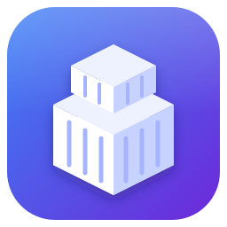
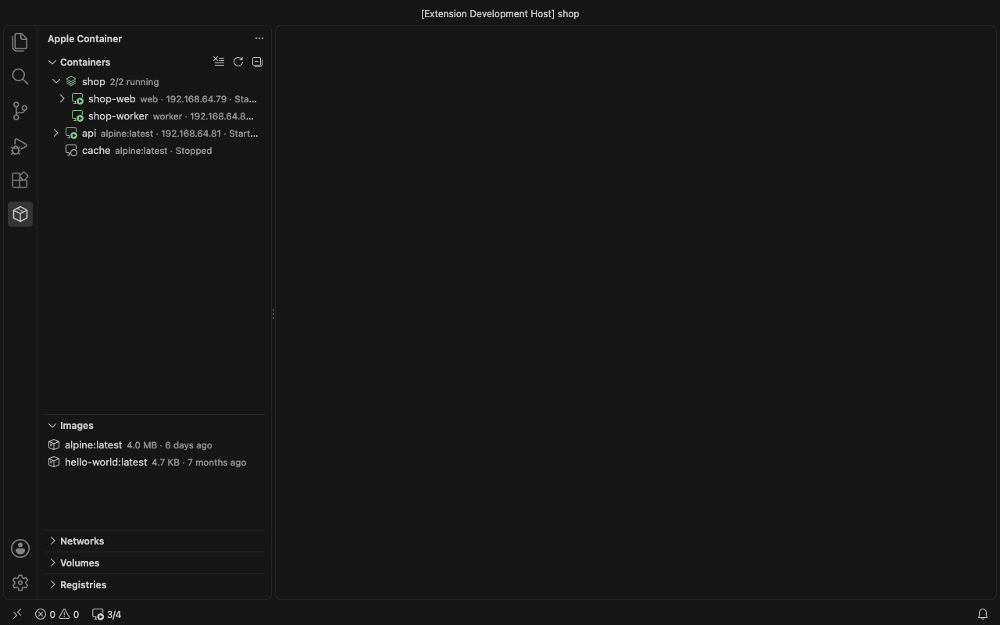
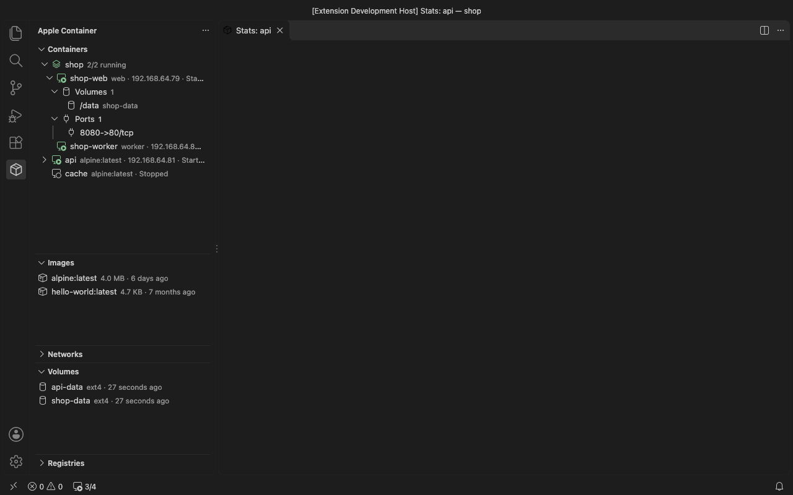
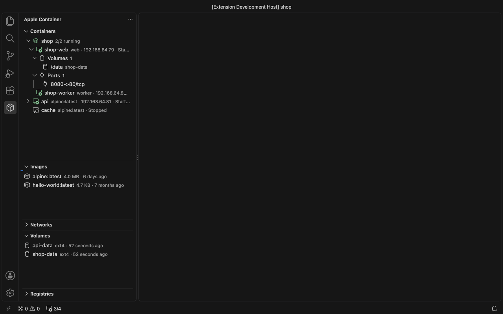

<div align="center">



# Apple Container Tools

**Manage [Apple `container`](https://github.com/apple/container), native Linux containers on macOS, from VS Code and Cursor.**

[](https://marketplace.visualstudio.com/items?itemName=fqix.apple-container-tools)
[](https://open-vsx.org/extension/fqix/apple-container-tools)
[](https://github.com/fqix/mac-container/actions/workflows/ci.yml)
[](#requirements)
[](LICENSE)

[Install](#installation) · [Features](#features) · [Remote-SSH](#open-a-container-over-remote-ssh) · [Dev containers](#dev-containers-devcontainerjson) · [Limitations](#limitations) · [Settings](#settings) · [Contributing](CONTRIBUTING.md) · English | [简体中文](README.zh-CN.md)



</div>

## Highlights

- 🧭 **One sidebar for everything**: containers, images, networks, volumes, registries, container-compose projects and the `container` system service.
- 🖥️ **Open a container as a remote workspace** in VS Code or Cursor over Remote-SSH, with no published port and no SSH daemon running. `openssh-server` is installed for you.
- 📦 **`devcontainer.json` without Docker**: open a folder in a dev container built and run by Apple `container`, with features and lifecycle commands, powered by the bundled Dev Containers CLI.
- 📝 **Run and edit containers in a form**: ports, mounts, environment variables, networks, CPUs, memory, user and working directory.
- 📊 **Live stats, logs, shell, file upload and download**, all from the context menu.
- 🌐 **Bilingual**: English and Simplified Chinese.

## Requirements

| | |
|---|---|
| Hardware | Mac with Apple silicon |
| `container` CLI | [apple/container](https://github.com/apple/container/releases), tested with 1.6.1 |
| Editor | VS Code 1.90 or later, or Cursor |
| Optional | [container-compose](https://github.com/mcrich23/container-compose) for compose projects; the Remote - SSH extension for remote workspaces and dev containers |

## Installation

- **VS Code**: install [Apple Container Tools](https://marketplace.visualstudio.com/items?itemName=fqix.apple-container-tools) from the Marketplace, or run `ext install fqix.apple-container-tools` in Quick Open (`⌘P`).
- **Cursor and other Open VSX editors**: install from [Open VSX](https://open-vsx.org/extension/fqix/apple-container-tools).
- **VSIX**: download `apple-container-tools-darwin-arm64-<version>.vsix` from [GitHub Releases](https://github.com/fqix/mac-container/releases) and install it:

  ```bash
  code --install-extension apple-container-tools-darwin-arm64-0.5.0.vsix
  ```

## Quick start

1. Start the service with `container system start`, or click the **container** item in the status bar.
2. Open the **Apple Container** view in the activity bar.
3. Right-click an image → **Run...**, or a running container → **Attach Shell**, **Show Stats** or **Open in Remote-SSH**.
4. Got a `.devcontainer/devcontainer.json`? Open the folder and accept **Open in Dev Container**.

## Features

### Containers

- Running containers first, with image, IP address and uptime; hover for command, networks, ports, resources and platform.
- Start, stop, restart, kill, delete (multi-select supported), prune stopped containers.
- **Attach Shell** (`container exec -it`), **View Logs** (`logs -f`) and **View Boot Logs** in the integrated terminal.
- Expand a container to see its **Volumes** and **Ports**. Open a TCP port in the browser, copy its URL, or reveal a bind-mounted folder in Finder.
- **Upload Files...** and **Download...** copy files and folders in and out of a running container; container paths are picked by browsing the container. Existing local files are never overwritten (a ` (1)` suffix is added). Files in the explorer have **Upload to Container...**.
- **Show Stats** opens live charts for CPU, memory, network I/O and block I/O.

  

- **Edit...** changes port forwarding, mounts, environment variables (one `KEY=VALUE` per line, or imported from `.env` files), networks, CPUs, memory, user and working directory.
  Apple `container` cannot change these on an existing container, so saving recreates it with the same image and command, keeping everything the form does not show (labels, DNS, capabilities, ulimits, platform).
  **Keep Changes and Recreate** commits the container to a snapshot image first, so files changed inside it survive. If the new container fails to start, the original one is restored.

  

### Images

- Pull, build from a `Dockerfile` / `Containerfile` (also from the explorer context menu), tag, inspect, delete, prune.
- **Build Image...** opens a form for the tag, build context, target stage (picked from the `FROM ... AS` stages), platforms (`linux/amd64` is built with Rosetta; several platforms make a multi-platform image), build arguments, secrets (`id=KEY[,env=VAR|,src=/path]`, for `RUN --mount=type=secret`), labels, no cache, pull and SSH agent forwarding. The options are remembered per Dockerfile.
- **Run...** opens the same form as **Edit...**, plus a name (a Docker-style random name such as `brave_hopper` when left empty) and an optional command or shell script (run with `/bin/sh -c`).
- **Push...** pushes an image (a new name tags it first; a finished build also offers to push).
- **Export to tar...** saves one or more images as an OCI archive; **Import from tar...** loads archives, also from the explorer context menu of a `.tar` file.
- Loopback registries such as `localhost:5000` are reached over http like Docker does; add other plain-http registries to `appleContainer.insecureRegistries`.

### Builder

Image builds run in a BuildKit container (`buildkit`) that `container build` starts on demand. It is shown in its own **Builder** view instead of among the containers.

- **Start**, **Stop** and **Restart Builder**, **View Logs** and **Inspect**.
- **Delete Builder...** resets a stuck builder and frees its build cache; the next build creates it again.
- The builder gets the CPUs and memory of the `build.cpus` / `build.memory` system properties (`container system property list`). The CLI recreates it whenever other values are asked for, so they are not set here.

### Networks, volumes and registries

- Networks: create with an optional subnet, inspect, delete, prune. The built-in `default` network is protected.
- Volumes: create with an optional size, inspect, delete, prune.
- Registries: log in (the password goes to `container registry login --password-stdin`, never on the command line), log out.

### container-compose

Containers started by [container-compose](https://github.com/mcrich23/container-compose) are grouped by project.

- Start / stop / restart / delete all containers of a project.
- **Compose Up** / **Compose Down** from the project, or from the context menu of a `compose.yml` / `docker-compose.yml` in the explorer or editor. The compose file is found in the workspace by project name (`name:` field, otherwise the folder name).

### System service

The status bar shows whether the `container` service is running and how many containers are up. Click it to start or stop the service, or to view status, disk usage and logs. When the CLI is missing or the service is stopped, the views explain what to do.

## Open a container over Remote-SSH

Right-click a running container → **Open in Remote-SSH**, confirm the folder, and a new VS Code or Cursor window connects to it.

ssh reaches the container through `ProxyCommand container exec -i <id> sshd -i`, so the container needs no IP route, published port or running SSH daemon. On each open the extension:

1. Installs `openssh-server` if the container has no `sshd`, using the image's package manager (`apk`, `apt-get`, `dnf`, `microdnf`, `yum` or `zypper`). This needs network access from the container; when it fails, or the image has no package manager, it shows the command to run yourself.
2. Generates SSH host keys if missing and adds its own public key to the user's `authorized_keys`. An account without a password (`!` in `/etc/shadow`, which sshd treats as locked) is changed to `*` so key login works.
3. Writes the container's environment (image `ENV`, `--env`, and `remoteEnv` for dev containers) to the user's `~/.ssh/environment`, read by sshd with `PermitUserEnvironment=yes`, so the VS Code server and terminals see the same variables as `container exec`.
4. Adds `Include ~/.ssh/apple-container/config` at the top of `~/.ssh/config` (or the file set in `remote.SSH.configFile`) if it is not there yet. Your configuration is preserved; the host entries (`apple-container.<id>`) and the key pair live in `~/.ssh/apple-container/`.

The user is the container's own user (image `USER` or `--user`, root by default) unless `appleContainer.sshUser` is set.
The VS Code / Cursor server is downloaded inside the container, so it needs internet access; otherwise enable `remote.SSH.localServerDownload`.

## Dev containers (devcontainer.json)

**Open Folder in Dev Container** reads the folder's `devcontainer.json` (`.devcontainer/devcontainer.json`, `.devcontainer.json` or `.devcontainer/<name>/devcontainer.json`), creates the container with Apple `container` and opens the workspace folder in it [over Remote-SSH](#open-a-container-over-remote-ssh). Opening a local folder that has one offers to do so; the file's context menu also has **Rebuild and Open Dev Container**.

The container is created by the [Dev Containers CLI](https://github.com/devcontainers/cli) (`@devcontainers/cli` 0.90.0), the reference implementation of the spec, so `devcontainer.json` behaves as it does with Docker, features included. It is bundled with the extension and runs on the editor's own Node runtime; nothing needs to be installed. The CLI talks to Apple `container` through a docker-compatible shim that ships with the extension (`dist/docker-shim.js`), and its log, including image builds, features and lifecycle commands, is shown in a task terminal.

The container is named `devc-<folder>-<hash>` and labelled with `devcontainer.local_folder` / `devcontainer.config_file`, so the next open reuses it. When the configuration or its Dockerfile changed since the last open, you are asked whether to rebuild.

| Property | Support |
|---|---|
| `image`, `build` | ✅ |
| `features` | ✅ installed into an image built on top of the base image |
| `workspaceFolder`, `workspaceMount`, `mounts` | ✅ |
| `containerEnv`, `remoteEnv`, `containerUser`, `remoteUser` | ✅ |
| Lifecycle commands, from `initializeCommand` (on this Mac) to `postAttachCommand` | ✅ |
| `appPort` | ✅ published with `container run --publish` |
| `forwardPorts` | ⚠️ not published; Remote-SSH forwards ports it sees listening in the container, and the container IP is reachable from the Mac |
| `hostRequirements.cpus` / `memory` | ✅ applied with `--cpus` / `--memory`; memory is at least `appleContainer.devcontainer.memory` (4G) |
| `capAdd`, `init`, `overrideCommand` | ✅ |
| `runArgs` | ⚠️ passed to `container run`; Docker-only options are dropped with a warning, see [Limitations](#limitations) |
| `privileged` | ⚠️ becomes `--cap-add ALL` |
| `securityOpt` | ❌ ignored with a warning |
| `dockerComposeFile` | ❌ not supported |
| `customizations.vscode.extensions` | ✅ installed once per container when its window connects, features' extensions included; VS Code and Cursor install from their own marketplace |

## Limitations

Apple `container` runs every container in its own lightweight VM with its own Linux kernel, not on a shared Docker daemon, so some Docker options have no equivalent (checked against `container` 1.6.1):

| Docker option | In Apple `container` |
|---|---|
| `--privileged` | Not available. Add capabilities with `--cap-add` / `capAdd` instead (`ALL` adds every capability). |
| `--ipc`, `--pid`, `--userns`, `--cgroupns` | Not available: there is no host kernel namespace to share. |
| `--device`, `--gpus`, bind mounts of `/dev` or `/run/udev` | Not available: the host is macOS, so there are no Linux devices to pass through. |
| `--security-opt`, `--add-host`, `--hostname` | Not available. |
| Docker Compose | Not available. [container-compose](#container-compose) projects are supported, `dockerComposeFile` in `devcontainer.json` is not. |
| Docker-in-Docker | Not available, as it needs privileged mode. |

For `devcontainer.json` this means:

- The docker shim drops `runArgs` that Apple `container` cannot apply (`--ipc`, `--pid`, `--security-opt`, `--device`, `--gpus`, `--add-host`, `--network host`, and mounts of `/dev`, `/proc`, `/sys` or of paths that do not exist on the Mac) and prints a warning in the task terminal. `--privileged` (also from `privileged: true` or a feature) becomes `--cap-add ALL`. The container starts, but whatever relied on those options does not work.
- Every Apple `container` container is a VM with a fixed amount of memory (1 GB unless set), while Docker containers share the whole Docker VM. Dev containers get `appleContainer.devcontainer.memory` (4G) or `hostRequirements.memory`, whichever is larger; raise it for heavy builds and rebuild the container.
- Features that need privileged mode or a Docker daemon, such as `docker-in-docker`, install but do not work. `docker-outside-of-docker` has no Docker socket to connect to.
- Configurations written for Codespaces or Docker that run containerd, Kubernetes or other nested container runtimes inside the dev container only partly work: anything that needs host devices or nested containers fails.

## Settings

| Setting | Default | Description |
|---|---|---|
| `appleContainer.path` | `container` | Path to the `container` CLI. Looked up in `PATH`, `/opt/homebrew/bin` and `/usr/local/bin`. |
| `appleContainer.composePath` | `container-compose` | Path to the `container-compose` CLI. |
| `appleContainer.insecureRegistries` | `[]` | Registries (`host` or `host:port`) reached over plain http. Loopback registries always are. |
| `appleContainer.refreshInterval` | `5` | Auto refresh interval in seconds while a view is visible; `0` disables it. |
| `appleContainer.statsInterval` | `2` | Sampling interval of the stats charts in seconds. |
| `appleContainer.execShell` | `/bin/sh` | Shell started by **Attach Shell**. |
| `appleContainer.logTail` | `200` | Lines shown when opening logs; `0` shows everything. |
| `appleContainer.sshUser` | _(empty)_ | User for **Open in Remote-SSH**. Empty uses the container's own user (image `USER` or `--user`, root by default). |
| `appleContainer.devcontainer.memory` | `4G` | Memory for dev containers, or `hostRequirements.memory` when larger. Apple `container` gives a container 1 GB by default, while Docker containers are not limited. Empty keeps the Apple `container` default. |

## FAQ

<details>
<summary><b>Does it work when my workspace is remote (SSH, Dev Containers, WSL)?</b></summary>

Yes. The extension runs on the local UI side (`extensionKind: ["ui"]`), so it always manages the containers of the Mac you are sitting at. Building images and running Compose need the files on this Mac; files from a remote workspace are rejected with a message.
</details>

<details>
<summary><b>Remote-SSH hangs while downloading the VS Code server.</b></summary>

The server is downloaded inside the container. If the container has no internet access, enable `remote.SSH.localServerDownload` so it is downloaded on the Mac and copied in.
</details>

<details>
<summary><b><code>Compose Down</code> left the containers behind.</b></summary>

`container-compose down` (1.2.0) stops the containers but does not remove them. Use **Delete All Containers** on the project to remove them.
</details>

<details>
<summary><b>Does it need Docker?</b></summary>

No. Everything goes through the `container` CLI; for dev containers, the bundled Dev Containers CLI reaches it through a docker-compatible shim. Docker-only options such as Compose and privileged mode are not available; see [Limitations](#limitations).
</details>

## Contributing

Issues and pull requests are welcome. See [CONTRIBUTING.md](CONTRIBUTING.md) for building, testing and translating the extension, and the [CHANGELOG](CHANGELOG.md) for what changed in each release.

## Acknowledgements

- [apple/container](https://github.com/apple/container), the container runtime this extension drives.
- [container-compose](https://github.com/mcrich23/container-compose) for Compose support on Apple `container`.
- The [Development Containers specification](https://containers.dev/) and the [Dev Containers CLI](https://github.com/devcontainers/cli), bundled to create dev containers.

## License

[MIT](LICENSE)
