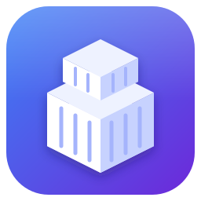
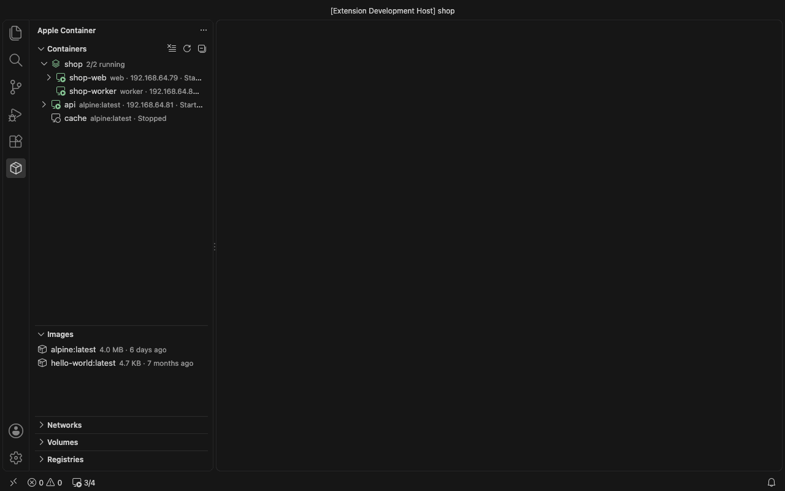
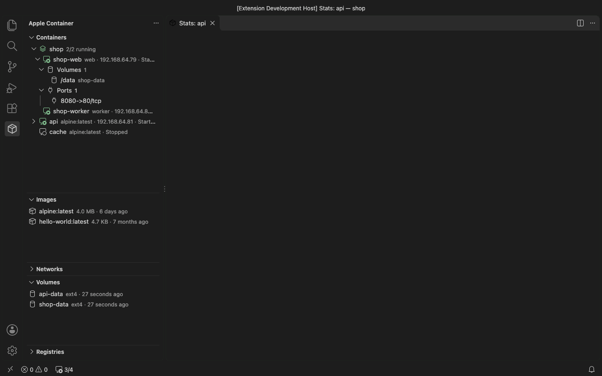
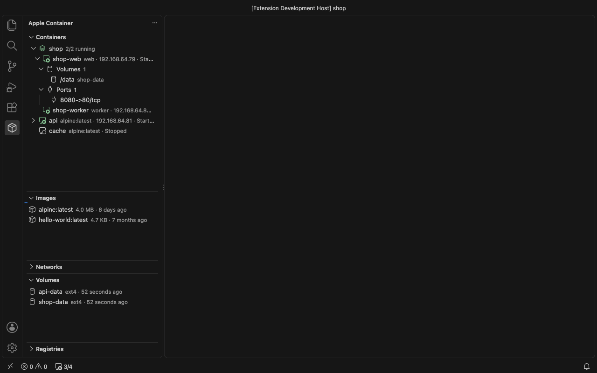
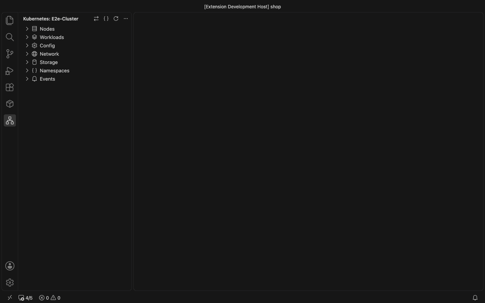

# Apple Container Tools

**在 VS Code 和 Cursor 中管理 [Apple `container`](https://github.com/apple/container)（macOS 原生 Linux 容器）。**

[安装](#安装) · [功能](#功能) · [Kubernetes](#kubernetes-集群) · [Remote-SSH](#remote-ssh) · [开发容器](#开发容器) · [设置](#设置) · [English](README.md) | 简体中文

## 亮点

- 🧭 **一个侧边栏** 管理容器、镜像、网络、卷、镜像仓库、container-compose 项目和 `container` 服务。
- ☸️ **Kubernetes 集群**：像 Lens 一样浏览 `container cluster` 创建的集群。
- 🐧 **Machine**：管理 `container machine` 创建的持久 Linux 环境，使用你在 Mac 上的用户和主目录。
- 🖥️ **把容器、Machine 和 Pod 作为远程工作区打开**：通过 Remote-SSH 连接，不需要端口映射，也不需要常驻 SSH 服务。
- 📦 **不依赖 Docker 的 `devcontainer.json`**，支持 features 和生命周期命令。
- 📝 用 **表单** 运行、编辑和构建，**中英双语**。

## 环境要求

| | |
|---|---|
| 硬件 | 搭载 Apple 芯片的 Mac |
| `container` CLI | [apple/container](https://github.com/apple/container/releases)，已在 1.7.1 上测试 |
| 编辑器 | VS Code 1.90 及以上，或 Cursor |
| 可选 | [container-compose](https://github.com/mcrich23/container-compose)；Remote - SSH 扩展；`kubectl`（缺少时可下载） |

## 安装

- **VS Code**：[Marketplace](https://marketplace.visualstudio.com/items?itemName=fqix.apple-container-tools)，或在快速打开（`⌘P`）中执行 `ext install fqix.apple-container-tools`。
- **Cursor 及其他 Open VSX 编辑器**：[Open VSX](https://open-vsx.org/extension/fqix/apple-container-tools)。
- **VSIX**：从 [GitHub Releases](https://github.com/fqix/mac-container/releases) 下载后执行 `code --install-extension apple-container-tools-darwin-arm64-0.10.0.vsix`

安装后打开活动栏中的 **Apple Container**；服务未运行时可在视图或状态栏中启动。

## 功能

### 容器

- 启动、停止、重启、强制终止、删除和清理；**打开 Shell**、**查看日志**、**上传文件...** / **下载...**。
- 展开容器可看到 **卷** 和 **端口**，包括容器内在监听但未发布的端口。
- **查看资源用量** 显示 CPU、内存、网络和磁盘的实时图表。

  

- **编辑...** 修改端口、挂载、环境变量、网络、CPU、内存和用户。Apple `container` 不能直接修改已有容器，所以会重建；**保留改动并重建** 会先打快照。

  

### 镜像及其他

- 镜像：拉取、打标签、推送、删除、清理、导出 / 导入 OCI 归档；**构建镜像...** 和 **运行...** 打开表单。
- 网络、卷、镜像仓库登录，以及 BuildKit 构建器。
- container-compose 项目自动分组，可整体启动、停止、删除，或 **Compose 启动** / **Compose 停止**。
- 状态栏可启动或停止服务，并打开 **系统概览**（版本、路径、磁盘占用，可直接清理）。

### Machine

`container machine`（container 1.7.1）创建的 machine 是一个持久的 Linux 环境：启动镜像自带的 `/sbin/init`，账户与你的 Mac 用户一致，Mac 主目录挂载到相同路径。**Machine** 视图列出所有 machine。

- **新建 Machine...** 依次选择镜像（必须带有 `/sbin/init`，例如 `alpine:latest`；输入镜像引用可直接拉取）、名称、CPU、内存和主目录挂载方式。
- **打开 Shell** / **以 root 打开 Shell** 打开登录 shell；终端所在文件夹在主目录下时，从同一路径开始。已停止的 machine 会先启动。
- 启动、停止、重启、**编辑...**（CPU、内存、主目录挂载，下次启动生效）、**设为默认**、日志、启动日志和删除。

### Kubernetes 集群

用 `container cluster`（container 1.7.1）创建的集群在 Activity Bar 上有单独的图标。

- 一次显示一个集群，名称在标题上；标题栏可 **切换集群...**、**切换命名空间...**，以及创建、删除集群或把 context 写入 kubeconfig。
- 和 Lens 一样分为节点、工作负载、配置、网络、存储、命名空间和事件，可 **查看 YAML**、**Describe**、**删除...**；Pod 可查看日志、打开 Shell、**在 Remote-SSH 中打开**；工作负载可重启和扩缩容。
- **新建资源...** 打开 YAML 模板，编辑器标题栏的 **应用到集群** 应用它（或任意 YAML 文件）。
- 通过 `kubectl` 访问（缺少时询问后从 dl.k8s.io 下载），使用扩展自己维护的 kubeconfig，不改动 `~/.kube/config`。

## Remote-SSH

右键运行中的容器、Machine 或 Pod → **在 Remote-SSH 中打开**，选择要打开的文件夹。新窗口经 `container exec` 连接（Machine 为 `container machine run`，会先启动已停止的 machine；Pod 为 `kubectl exec`），不需要端口或 IP 路由。Machine 以它自己的账户登录，与你的 Mac 用户一致。

- 缺少的 `openssh-server`、`bash`、`wget` 会用镜像自带的包管理器安装（需要访问外网）；Pod 的容器需以 root 运行。
- `~/.ssh/config` 只多一行 `Include ~/.ssh/apple-container/config`；主机条目和密钥对放在 `~/.ssh/apple-container/`。

## 开发容器

**在开发容器中打开文件夹** 用内置的 [Dev Containers CLI](https://github.com/devcontainers/cli) 按 `devcontainer.json` 创建容器，再通过 Remote-SSH 打开。下次打开会复用容器，配置有改动时询问是否重建；窗口的远程菜单提供 **重建容器** 和 **在本地重新打开文件夹**。

还没有配置？**添加 Dev Container 配置...**（命令面板或文件夹右键菜单）用官方 [Dev Container 模板](https://containers.dev/templates) 生成配置，可选择模板选项和 Feature。模板随插件打包，离线也能用；需要 Docker Compose 或 Docker 守护进程的模板，以及需要 Docker 或 GPU 的 Feature，不会列出。还可以选择用官方安装脚本在 `postCreateCommand` 里安装 Claude Code、Codex 或 opencode，并把它们加入 bash 和 zsh 的 `PATH`。

| 配置项 | 支持情况 |
|---|---|
| `image`、`build`、`features`、挂载、环境变量、用户、生命周期命令 | ✅ |
| `appPort`、`capAdd`、`init`、`overrideCommand`、`hostRequirements` | ✅ |
| `customizations.vscode.extensions` | ✅ 窗口连上后安装 |
| `forwardPorts` | ⚠️ 由 Remote-SSH 转发，不发布 |
| `runArgs`、`privileged` | ⚠️ 见[已知限制](#已知限制) |
| `securityOpt`、`dockerComposeFile` | ❌ |

## 已知限制

Apple `container` 的每个容器都是独立的轻量虚拟机，而不是共享 Docker daemon 的进程（基于 1.7.1 核实）。`devcontainer.json` 中没有对应能力的 Docker 选项会被丢弃并给出警告。

| Docker 选项 | Apple `container` 中 |
|---|---|
| `--privileged` | 转为 `--cap-add ALL`。 |
| `--ipc`、`--pid`、`--userns`、`--cgroupns`、`--network host` | 不支持：没有共享的宿主内核。 |
| `--device`、`--gpus`、挂载 `/dev`、`/proc`、`/sys` | 不支持：宿主是 macOS。 |
| `--security-opt`、`--add-host`、`--hostname`、Docker Compose、Docker-in-Docker | 不支持。 |

每个容器的内存是固定的（默认 1 GB），开发容器使用 `appleContainer.devcontainer.memory`。

## 设置

| 设置项 | 默认值 | 说明 |
|---|---|---|
| `appleContainer.path` | `container` | `container` CLI，也会在 `/opt/homebrew/bin`、`/usr/local/bin` 中查找 |
| `appleContainer.composePath` | `container-compose` | `container-compose` CLI |
| `appleContainer.kubectlPath` | | 浏览集群用的 `kubectl`；留空时使用 `PATH` 中的，再用下载的 |
| `appleContainer.cluster.kubeconfig` | | 创建、删除集群时更新的 kubeconfig；留空时用 `KUBECONFIG`，否则 `~/.kube/config` |
| `appleContainer.insecureRegistries` | `[]` | 使用 http 访问的镜像仓库 |
| `appleContainer.refreshInterval` | `5` | 视图可见时的刷新间隔（秒），`0` 关闭 |
| `appleContainer.statsInterval` | `2` | 资源用量图表的采样间隔（秒） |
| `appleContainer.execShell` | `/bin/sh` | **打开 Shell** 使用的 shell |
| `appleContainer.logTail` | `200` | 日志先显示的行数，`0` 表示全部 |
| `appleContainer.sshUser` | | **在 Remote-SSH 中打开** 的登录用户；留空使用容器自身的用户 |
| `appleContainer.devcontainer.memory` | `4G` | 开发容器的内存，`hostRequirements.memory` 更大时以它为准 |

## 常见问题

<b>工作区在远程（SSH、Dev Containers、WSL）时能用吗？</b>

可以。插件运行在本地 UI 端，管理的始终是这台 Mac 上的容器。构建镜像和 Compose 需要本机上的文件。

<b>Remote-SSH 卡在下载 VS Code Server。</b>

容器无法访问外网时，开启 `remote.SSH.localServerDownload`，改为在 Mac 上下载后复制进容器。

<b><code>Compose 停止</code> 后容器还在。</b>

`container-compose down`（1.2.0）只停止、不删除容器。需要删除时在项目上用 **删除全部容器**。

## 参与贡献

欢迎提交 Issue 和 Pull Request，见 [CONTRIBUTING.md](CONTRIBUTING.md) 和 [CHANGELOG](CHANGELOG.md)。本插件基于 [apple/container](https://github.com/apple/container)、[container-compose](https://github.com/mcrich23/container-compose) 和 [Dev Containers CLI](https://github.com/devcontainers/cli)。

## 许可证

[MIT](LICENSE)
