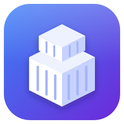
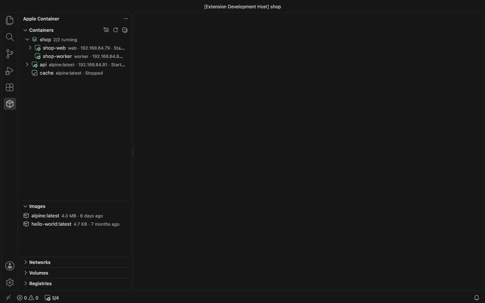
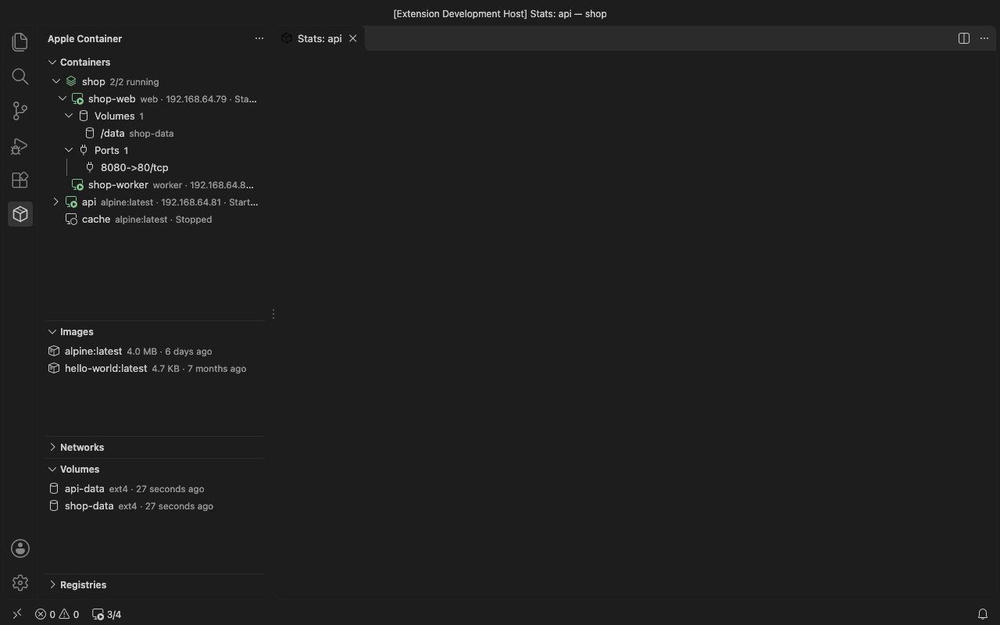
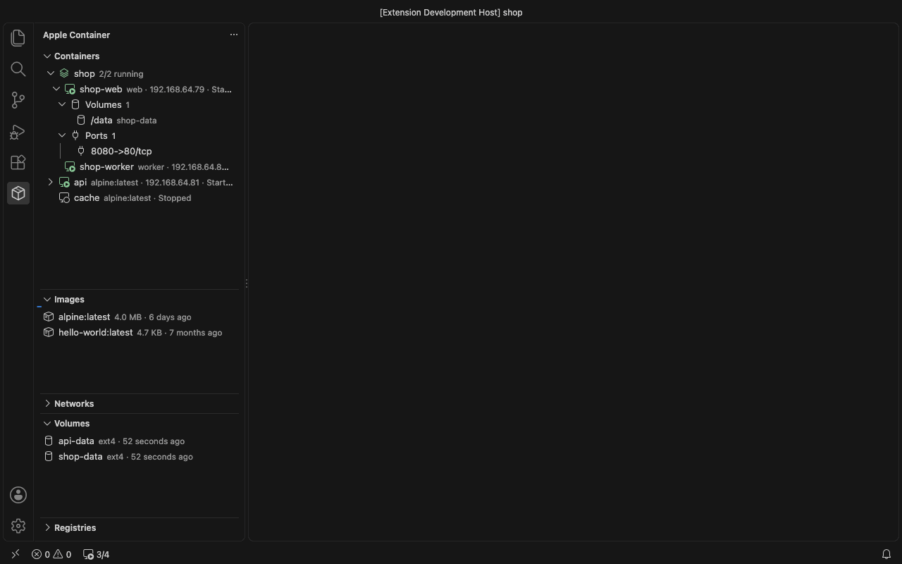

<div align="center">



# Apple Container Tools

**在 VS Code 和 Cursor 中管理 [Apple `container`](https://github.com/apple/container)（macOS 原生 Linux 容器）。**

[](https://marketplace.visualstudio.com/items?itemName=fqix.apple-container-tools)
[](https://open-vsx.org/extension/fqix/apple-container-tools)
[](https://github.com/fqix/mac-container/actions/workflows/ci.yml)
[](#环境要求)
[](LICENSE)

[安装](#安装) · [功能](#功能) · [Remote-SSH](#通过-remote-ssh-打开容器) · [开发容器](#开发容器devcontainerjson) · [已知限制](#已知限制) · [设置](#设置) · [参与贡献](CONTRIBUTING.md) · [English](README.md) | 简体中文



</div>

## 亮点

- 🧭 **一个侧边栏** 管理容器、镜像、网络、卷、镜像仓库、container-compose 项目和 `container` 服务。
- 🖥️ **把容器作为远程工作区打开**：通过 Remote-SSH 连接，不需要端口映射，也不需要常驻 SSH 服务。
- 📦 **不依赖 Docker 的 `devcontainer.json`**，支持 features 和生命周期命令。
- 📝 **用表单运行和编辑容器**，构建镜像时可设置构建参数、Secrets 和平台。
- 🌐 **中英双语**。

## 环境要求

| | |
|---|---|
| 硬件 | 搭载 Apple 芯片的 Mac |
| `container` CLI | [apple/container](https://github.com/apple/container/releases)，已在 1.6.1 上测试 |
| 编辑器 | VS Code 1.90 及以上，或 Cursor |
| 可选 | [container-compose](https://github.com/mcrich23/container-compose)（compose 项目）；Remote - SSH 扩展（远程工作区和开发容器） |

## 安装

- **VS Code**：从 Marketplace 安装 [Apple Container Tools](https://marketplace.visualstudio.com/items?itemName=fqix.apple-container-tools)，或在快速打开（`⌘P`）中执行 `ext install fqix.apple-container-tools`。
- **Cursor 及其他使用 Open VSX 的编辑器**：从 [Open VSX](https://open-vsx.org/extension/fqix/apple-container-tools) 安装。
- **VSIX**：从 [GitHub Releases](https://github.com/fqix/mac-container/releases) 下载 `apple-container-tools-darwin-arm64-<version>.vsix` 后安装：

  ```bash
  code --install-extension apple-container-tools-darwin-arm64-0.7.0.vsix
  ```

## 快速上手

1. 执行 `container system start` 启动服务，或点击状态栏中的 **container**。
2. 打开活动栏中的 **Apple Container** 视图。
3. 右键镜像 → **运行...**；或右键运行中的容器 → **打开 Shell**、**查看资源用量**、**在 Remote-SSH 中打开**。
4. 项目里有 `.devcontainer/devcontainer.json`？打开文件夹后在提示中选择 **在开发容器中打开**。

## 功能

### 容器

- 启动、停止、重启、强制终止、删除（支持多选）和清理；在终端中 **打开 Shell**、**查看日志**、**查看启动日志**。
- 展开容器可以看到 **卷** 和 **端口**。端口里也包括容器内在监听但未发布的端口，通过容器 IP 打开。
- 逐级浏览容器目录来 **上传文件...** / **下载...**；**查看资源用量** 显示 CPU、内存、网络和磁盘的实时图表。

  

- **编辑...** 修改端口、挂载、环境变量、网络、CPU、内存、用户和工作目录。Apple `container` 不能直接修改已有容器，所以会重建容器；**保留改动并重建** 会先打快照，容器内改过的文件不会丢失。

  

### 镜像

- 拉取、打标签、推送、查看详情、删除、清理，以及导出 / 导入 OCI tar 归档。
- **构建镜像...** 打开表单，可设置标签、构建上下文、目标阶段、平台（含多平台）、构建参数、Secrets 和标签。
- **运行...** 打开与 **编辑...** 相同的表单，另可填写名称和命令。

### 其他

- **构建器**：`container build` 启动的 BuildKit 容器显示在容器列表中，可以启动、停止、重启、查看日志，**删除构建器...** 可重置它并释放构建缓存。
- **网络**、**卷** 和 **镜像仓库登录**。
- **container-compose**：容器按项目分组，可对整个项目启动、停止、重启、删除；在项目或 compose 文件上执行 **Compose 启动** / **Compose 停止**。
- **状态栏**：显示服务是否运行以及运行中的容器数；点击可启动或停止服务，或查看状态、磁盘占用和日志。

## 通过 Remote-SSH 打开容器

右键运行中的容器 → **在 Remote-SSH 中打开**，浏览容器目录选择要打开的文件夹。新的 VS Code 或 Cursor 窗口通过 `container exec` 连接容器，不需要端口或 IP 路由。

- 镜像里缺少的 Remote-SSH 依赖（`openssh-server`、`bash`、`wget`）会用镜像自带的包管理器安装，过程显示在终端中。这需要容器能访问外网。
- 你的 SSH 配置只会多一行：`~/.ssh/config` 顶部的 `Include ~/.ssh/apple-container/config`；主机条目和插件的密钥对放在 `~/.ssh/apple-container/`。
- 登录用户是容器自身的用户（镜像 `USER` 或 `--user`），也可以用 `appleContainer.sshUser` 指定。

## 开发容器（devcontainer.json）

**在开发容器中打开文件夹** 用内置的 [Dev Containers CLI](https://github.com/devcontainers/cli)（规范的参考实现）按文件夹中的 `devcontainer.json` 创建容器，再通过 Remote-SSH 打开。构建和 Remote-SSH 准备在同一个终端中分步显示。下次打开会复用容器，配置有改动时会询问是否重建。

在开发容器的窗口中，远程指示器菜单和命令面板提供 **重建容器**、**不使用缓存重建容器**、**在本地重新打开文件夹** 和 **显示开发容器日志**。

| 配置项 | 支持情况 |
|---|---|
| `image`、`build`、`features` | ✅ |
| `workspaceFolder`、`workspaceMount`、`mounts` | ✅ |
| `containerEnv`、`remoteEnv`、`containerUser`、`remoteUser` | ✅ |
| 生命周期命令，`initializeCommand` 到 `postAttachCommand` | ✅ |
| `appPort`、`capAdd`、`init`、`overrideCommand`、`hostRequirements` | ✅ |
| `customizations.vscode.extensions` | ✅ 窗口连上后安装，从编辑器自己的扩展市场下载 |
| `forwardPorts` | ⚠️ 不发布；由 Remote-SSH 转发，**端口** 中也会以容器 IP 列出 |
| `runArgs`、`privileged` | ⚠️ 见[已知限制](#已知限制) |
| `securityOpt`、`dockerComposeFile` | ❌ |

## 已知限制

Apple `container` 的每个容器都是独立的轻量虚拟机，有自己的 Linux 内核，而不是共享 Docker daemon 的进程，所以部分 Docker 选项没有对应能力（基于 `container` 1.6.1 核实）。`devcontainer.json` 中（`runArgs`、`privileged` 或 features 带来的）这类选项会被丢弃并给出警告，容器仍能启动。

| Docker 选项 | Apple `container` 中 |
|---|---|
| `--privileged` | 转为 `--cap-add ALL`。 |
| `--ipc`、`--pid`、`--userns`、`--cgroupns`、`--network host` | 不支持：没有共享的宿主内核。 |
| `--device`、`--gpus`、挂载 `/dev`、`/proc` 或 `/sys` | 不支持：宿主是 macOS。 |
| `--security-opt`、`--add-host`、`--hostname` | 不支持。 |
| Docker Compose、Docker-in-Docker | 不支持。支持 [container-compose](https://github.com/mcrich23/container-compose) 项目，不支持 `dockerComposeFile`。 |

另外每个容器的内存是固定的（默认 1 GB），开发容器使用 `appleContainer.devcontainer.memory`。

## 设置

| 设置项 | 默认值 | 说明 |
|---|---|---|
| `appleContainer.path` | `container` | `container` CLI 路径，默认从 `PATH`、`/opt/homebrew/bin`、`/usr/local/bin` 查找 |
| `appleContainer.composePath` | `container-compose` | `container-compose` CLI 路径 |
| `appleContainer.insecureRegistries` | `[]` | 使用 http 访问的镜像仓库（`host` 或 `host:port`），本机回环地址始终使用 http |
| `appleContainer.refreshInterval` | `5` | 视图可见时的自动刷新间隔（秒），`0` 关闭 |
| `appleContainer.statsInterval` | `2` | 资源用量图表的采样间隔（秒） |
| `appleContainer.execShell` | `/bin/sh` | **打开 Shell** 使用的 shell |
| `appleContainer.logTail` | `200` | 查看日志时显示的末尾行数，`0` 表示全部 |
| `appleContainer.sshUser` | _（空）_ | **在 Remote-SSH 中打开** 时登录的用户；留空使用容器自身的用户 |
| `appleContainer.devcontainer.memory` | `4G` | 开发容器的内存，`hostRequirements.memory` 更大时以它为准；留空使用 Apple `container` 默认的 1 GB |

## 常见问题

<details>
<summary><b>工作区在远程（SSH、Dev Containers、WSL）时能用吗？</b></summary>

可以。插件运行在本地 UI 端，管理的始终是你这台 Mac 上的容器。构建镜像和 Compose 需要本机上的文件。
</details>

<details>
<summary><b>Remote-SSH 卡在下载 VS Code Server。</b></summary>

Server 是在容器内下载的。容器无法访问外网时，开启 `remote.SSH.localServerDownload`，改为在 Mac 上下载后复制进容器。
</details>

<details>
<summary><b><code>Compose 停止</code> 后容器还在。</b></summary>

`container-compose down`（1.2.0）只停止容器、不删除。需要删除时在项目上用 **删除全部容器**。
</details>

## 参与贡献

欢迎提交 Issue 和 Pull Request。构建、测试和翻译说明见 [CONTRIBUTING.md](CONTRIBUTING.md)，各版本变更见 [CHANGELOG](CHANGELOG.md)。

## 致谢

- [apple/container](https://github.com/apple/container)：本插件驱动的容器运行时。
- [container-compose](https://github.com/mcrich23/container-compose)：为 Apple `container` 提供 Compose 支持。
- [Development Containers 规范](https://containers.dev/) 和 [Dev Containers CLI](https://github.com/devcontainers/cli)：内置用于创建开发容器。

## 许可证

[MIT](LICENSE)
